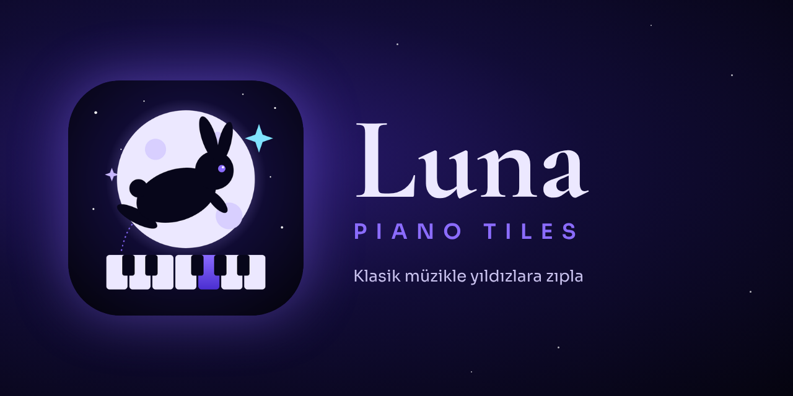
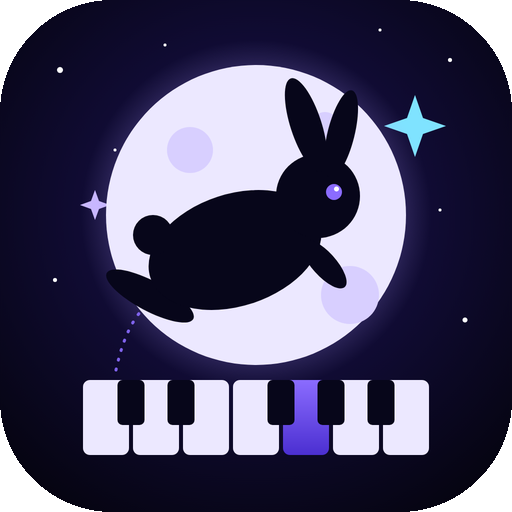
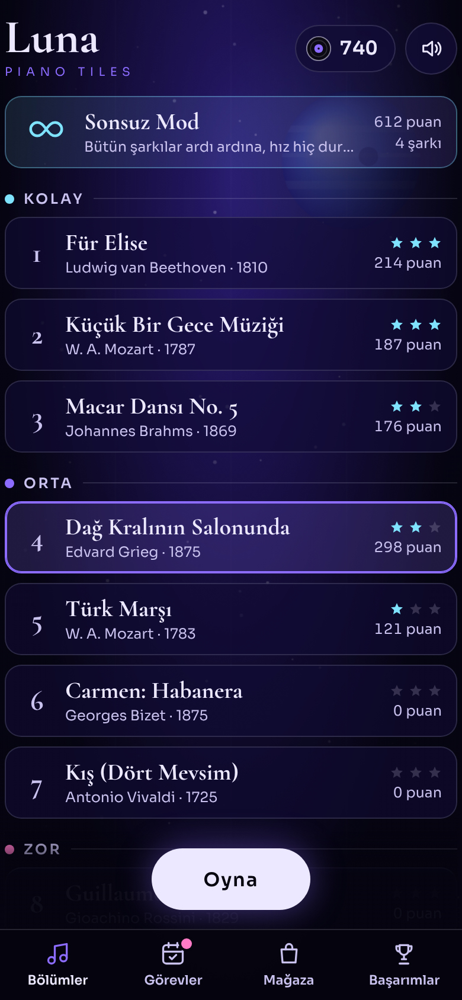
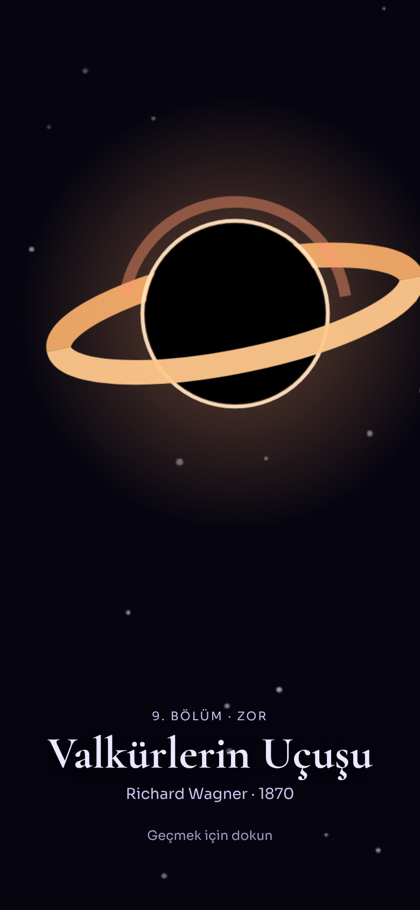
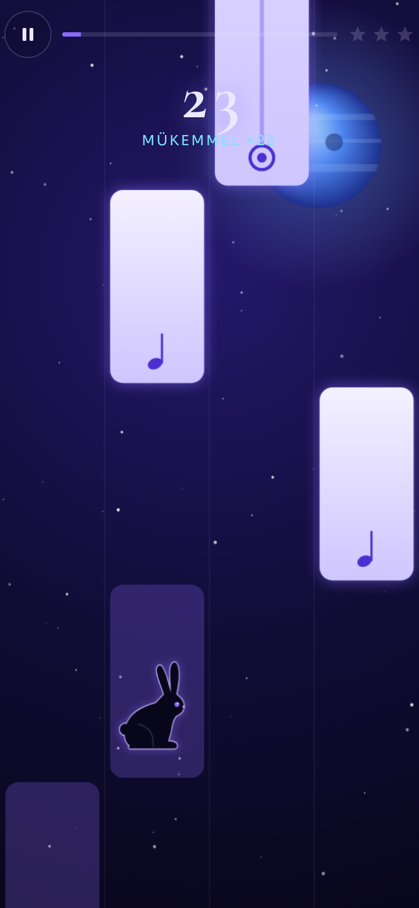
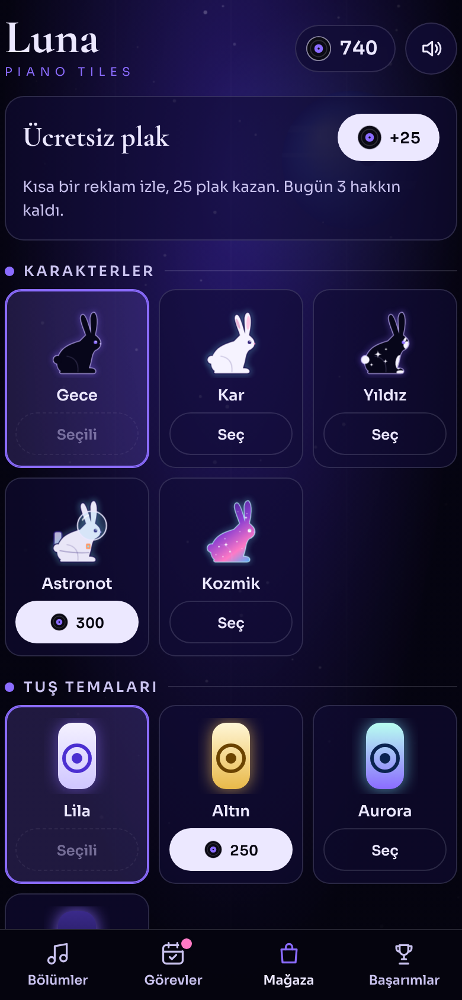
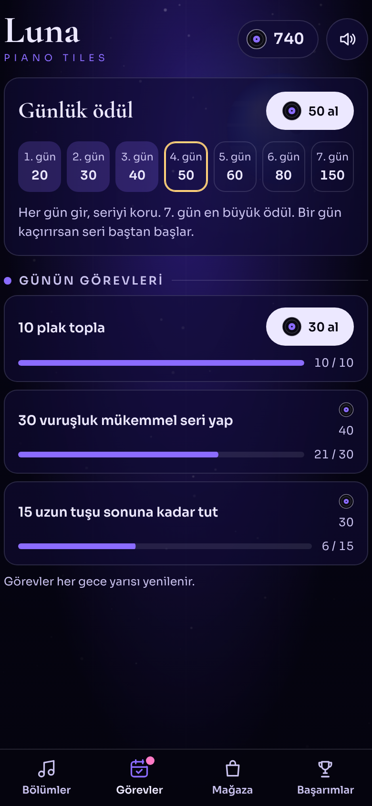
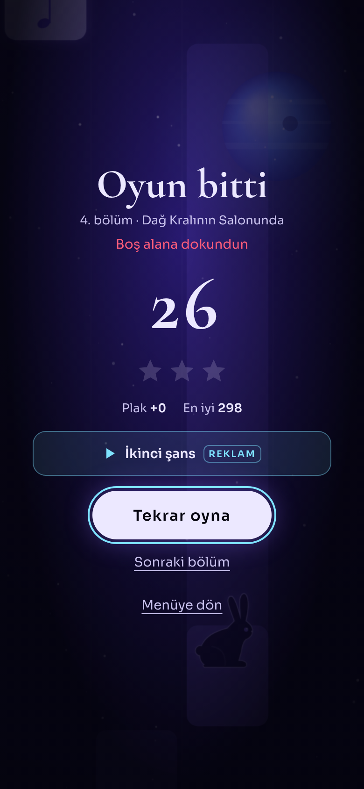

<p align="center">
  
</p>

<p align="center">
  
</p>

<h1 align="center">Luna Piano Tiles</h1>

<p align="center">
  Siyah bir tavşanın uzayda piyano tuşlarının üstünde zıpladığı, klasik müzikli bir ritim oyunu.
</p>

<p align="center">
  
  
  
</p>

---

## Ekran görüntüleri

<table>
  <tr>
    <td align="center"><br><sub>Bölümler</sub></td>
    <td align="center"><br><sub>Bölüm sinematiği</sub></td>
    <td align="center"><br><sub>Oynanış</sub></td>
  </tr>
  <tr>
    <td align="center"><br><sub>Plak mağazası</sub></td>
    <td align="center"><br><sub>Günlük ödül ve görevler</sub></td>
    <td align="center"><br><sub>Oyun sonu</sub></td>
  </tr>
</table>

## Nasıl oynanır

Dört şeritte piyano tuşları aşağı akar. Işıklı tuşlara dokun, tavşan dokunduğun tuşa zıplasın ve nota çalsın.

- **Kısa tuş:** bir kez dokun.
- **Uzun tuş** (halka simgeli): basılı tut, sonuna kadar tutarsan **+2** bonus.
- **Siyah plaklar:** tuşların yanında dönerek gelir, yakalarsan **+5 puan** ve **1 plak**.
- Boş alana dokunursan ya da bir tuşu kaçırırsan oyun biter.
- Bilgisayarda **Q W E R** tuşlarıyla oynanır.

## Özellikler

- **10 bölüm**, Kolay / Orta / Zor kategorilerinde; her bölüm 3 yıldız ve kendi rekoru
- **Sonsuz mod:** bütün şarkılar ardı ardına çalar, tempo hiç durmadan artar
- **Bölüm sinematiği:** her bölüm kendi gök cismine yaklaşarak başlar
- **5 tavşan:** Gece, Kar, Yıldız, Astronot, Kozmik
- **4 tuş teması:** Lila, Altın, Aurora, Obsidyen
- **Plak ekonomisi:** toplanan plaklarla karakter ve tema açılır
- **Günlük ödül** (7 günlük seri) ve **her gün 3 yeni görev**
- **10 başarım** ve bölüm bazında rekorlar
- **Ödüllü reklam** (ikinci şans, plakları 2 katına çıkarma, ücretsiz plak) ve çok seyrek bölüm arası reklam
- **Reklamsız Luna** tek seferlik satın alımı
- Tamamen kodla üretilen, **telifsiz** piyano ve efekt sesleri
- Android'de tam ekran, dikey, ekran kararmaz, geri tuşu oyunu duraklatır

## Bölümler

| # | Kategori | Eser | Besteci | Yıl | Gök cismi |
|---|---|---|---|---|---|
| 1 | Kolay | Für Elise | Ludwig van Beethoven | 1810 | Ay |
| 2 | Kolay | Küçük Bir Gece Müziği | W. A. Mozart | 1787 | Satürn |
| 3 | Kolay | Macar Dansı No. 5 | Johannes Brahms | 1869 | Mars |
| 4 | Orta | Dağ Kralının Salonunda | Edvard Grieg | 1875 | Neptün |
| 5 | Orta | Türk Marşı | W. A. Mozart | 1783 | Jüpiter |
| 6 | Orta | Carmen: Habanera | Georges Bizet | 1875 | Venüs |
| 7 | Orta | Kış (Dört Mevsim) | Antonio Vivaldi | 1725 | Uranüs |
| 8 | Zor | Guillaume Tell Uvertürü | Gioachino Rossini | 1829 | Güneş |
| 9 | Zor | Valkürlerin Uçuşu | Richard Wagner | 1870 | Kara delik |
| 10 | Zor | Bumblebee'nin Uçuşu | Nikolay Rimsky-Korsakov | 1900 | Pulsar |

## Müzik ve telif

- Bütün eserler **kamu malı** (bestecilerin ölümünün üzerinden 70 yıldan fazla geçti).
- Oyunda **hiçbir hazır kayıt yoktur.** Melodiler projeye özel, sadeleştirilmiş düzenlemelerdir ve nota verisi olarak `www/index.html` içindeki `SONGS` listesinde durur.
- Piyano, bas ve bütün efektler Web Audio ile **kodla sentezlenir**. Notalar bölüm başında bir kez önceden işlenir, dokunuşta hazır ses çalınır.
- Yazı tipleri (Sora, Cormorant Garamond) **SIL Open Font License 1.1** ile lisanslıdır, lisans metinleri `www/fonts/` içindedir.

## Hemen dene

**Tarayıcıda:** `www/index.html` dosyasını açman yeterli, kurulum gerekmez.

**Telefonda:** [Releases](../../releases) sayfasından son APK'yı indirip kur. Telefon "bilinmeyen kaynak" izni isteyebilir.

## Android derleme (Android Studio)

Play Store'a çıkacak sürüm bu yolla hazırlanır.

1. Android Studio ile `android/` klasörünü aç. Gradle senkronizasyonunu bekle.
2. Oyun dosyaları `www/` klasöründen otomatik olarak APK'ya `assets` olarak girer.
3. Telefonda denemek için **Run ▶**.
4. Mağaza için **Build › Generate Signed App Bundle / APK** ile **AAB** üret. Bunu kendi yükleme anahtarınla (upload key) imzala.

Komut satırından:

```bash
cd android
./gradlew assembleDebug        # app/build/outputs/apk/debug/app-debug.apk
./gradlew bundleRelease        # Play Store için AAB (imza ayarı gerekir)
```

> İmza anahtarlarını (`.jks`, `.keystore`) **asla** depoya ekleme. `.gitignore` bunları zaten dışarıda bırakıyor.

## Hızlı test APK'sı (Android Studio olmadan)

Sadece telefonda denemek için Gradle ve Android SDK kurmadan imzalı bir APK üretir. Bunun için Java 11+, Node.js ve Python 3 + `cryptography` gerekir.

```bash
pip install cryptography
tools/quick-apk/build.sh       # → tools/quick-apk/out/Luna-Piano-Tiles-test.apk
```

Betik npm'den apktool 2.4.1'i indirir, `smali/` içindeki WebView kabuğunu derler, oyunu ve simgeleri ekler. Ardından zip hizalaması yapar ve APK Signature Scheme v2 ile imzalar. Bu yolla üretilen APK **sadece test içindir**, Play Store'a yüklenmez.

## Proje yapısı

```
luna-piano-tiles/
├── www/                    # Oyunun kendisi (tek HTML + yazı tipleri)
│   ├── index.html
│   └── fonts/
├── android/                # Android Studio / Gradle projesi (WebView kabuğu)
│   └── app/src/main/
│       ├── java/com/lunapiano/tiles/MainActivity.java
│       ├── res/            # Uygulama simgeleri (uyarlanabilir simge dahil)
│       └── AndroidManifest.xml
├── tools/quick-apk/        # Android Studio olmadan test APK'sı üretme araçları
├── docs/                   # Logo, kapak görseli, ekran görüntüleri
└── README.md
```

## Reklam, satın alma ve Google Play Games

Oyun bu servislere tek bir platform katmanı üzerinden bağlanır: `window.LunaPlatform`. Bu katman tanımlı değilse oyun **test modunda** çalışır. Bu durumda gerçek reklam yerine sayaçlı bir test kutusu, gerçek ödeme yerine "test" onay ekranı açılır.

Uygulama sürümünde Android tarafı şu fonksiyonları sağlar:

| Fonksiyon | Servis |
|---|---|
| `rewarded()` → `Promise<boolean>` | AdMob ödüllü reklam |
| `interstitial()` → `Promise` | AdMob geçiş reklamı |
| `buyNoAds()` → `Promise<boolean>` | Google Play Billing |
| `restore()` → `Promise<boolean>` | Satın alımı geri yükleme |
| `unlock(id)` | Play Games başarımı |
| `submitScore(board, score)` | Play Games liderlik tablosu |

## Yol haritası

- [ ] AdMob, Google Play Billing ve Play Games entegrasyonu
- [ ] Gerçek, serbest lisanslı piyano örnekleri
- [ ] Ayarlar: ses düzeyleri, titreşim, gecikme kalibrasyonu
- [ ] Daha fazla bölüm ve tavşan
- [ ] Gizlilik politikası sayfası (Play Store için gerekli)

## Lisans

Kaynak kod [MIT](LICENSE) lisanslıdır. Yazı tipleri SIL OFL 1.1 ile lisanslıdır.
